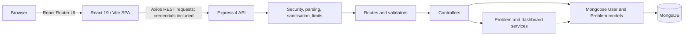

# Architecture — Placement Preparation Tracker

Updated 2026-11-17. This describes the checked-in implementation.

## System overview



During local development Vite proxies `/api` to `http://localhost:5000`. The browser stores the JWT in an HttpOnly cookie and sends it with Axios requests. The server verifies it independently on protected endpoints.

## Client

`client/src/App.jsx` uses `BrowserRouter`, `Routes`, and `Route` from React Router. `/`, `/login`, `/register`, `/terms`, and `/privacy` are public. `/dashboard` is wrapped in `ProtectedRoute`. `AuthContext` hydrates the session by calling `/api/auth/me`, then exposes login, registration, and logout actions. Dashboard subviews are tabs inside `DashboardPage`, not separate routes.

The shared Axios instance in `client/src/api/axios.js` uses `VITE_API_URL` or `/api`, sets `withCredentials: true`, JSON headers and a 10-second timeout. Dashboard pages call the API and render returned database values with loading, error, and empty states.

## Server and request lifecycle

The server entry point is `server/server.js`. On direct startup it awaits the Mongoose connection before opening the HTTP listener; a connection failure is logged and exits non-zero without listening. It configures Helmet and allowlisted credentialed CORS, parses JSON and cookies, sanitises request body/params, conditionally logs requests in development, then rate limits `/api`. It mounts auth, problem, and dashboard routers, followed by `/api/health`, not-found handling, and the central error handler. The health route returns 200 only while MongoDB is connected and 503 otherwise.

Protected problem/dashboard requests pass through `protect`: it reads `req.cookies.token`, verifies JWT signature/expiry, loads the account, then attaches the user to `req`. Route validators run before controllers. Controllers handle HTTP input/output and delegate problem or dashboard work to services. Services query Mongoose; every problem query is scoped to the authenticated user ID. The error middleware converts known validation, cast, and duplicate-key errors to consistent JSON responses.

```mermaid
sequenceDiagram
  participant B as Browser
  participant E as Express middleware/router
  participant C as Controller
  participant S as Service
  participant M as Mongoose
  participant D as MongoDB
  B->>E: Request + HttpOnly token cookie
  E->>E: Verify token; validate request
  E->>C: Attach authenticated user
  C->>S: User ID + validated input
  S->>M: User-scoped query/aggregation
  M->>D: Database operation
  D-->>M: Documents/results
  M-->>S: Results
  S-->>C: Domain result
  C-->>B: JSON response
```

## Authentication lifecycle

Registration validates name/email/password/terms acceptance, creates a User (whose pre-save hook hashes the password), signs a seven-day JWT and sets an HttpOnly, SameSite=Strict cookie. Login fetches the password hash explicitly and compares it with bcryptjs; both unknown email and wrong password return the same error. `/api/auth/me` verifies and returns the user profile. Logout clears the cookie; it does not revoke an already copied JWT before expiry.

The cookie's `Secure` flag is enabled in production. CORS allows the configured frontend origin and credentials. `SameSite=Strict` is the CSRF mitigation; there is no synchronizer token.

## Data model

MongoDB has `users` and `problems` collections. A Problem references its owner with `userId`; it is not embedded in User. This supports user-scoped pagination and avoids an ever-growing user document. Dashboard aggregations always filter by `userId`. See [DATABASE_DESIGN.md](DATABASE_DESIGN.md).

## Repository layout

```text
placement-tracker/client/src/{api,components,contexts,pages}
placement-tracker/server/{config,controllers,middleware,models,routes,services,tests,validators}
docs/
```

There is no `authService.js`, `topicRoutes.js`, or separate route per dashboard tab in the current implementation. Authentication controller logic resides in `controllers/authController.js`.
