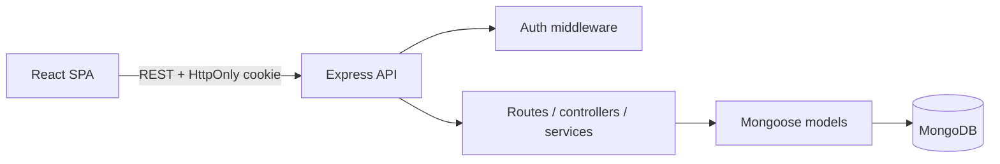

# Project Overview — Placement Preparation Tracker

> **Status:** Core application implemented; backend dependencies and verification are being repaired. Updated 2026-11-17.

## What it does

Placement Preparation Tracker is a React single-page application backed by an Express REST API and MongoDB. Students can register, record DSA problems, organise them by topic and difficulty, save notes, flag revision items, and view statistics calculated from their own problem records. A new account starts with no problem records; the dashboard's zero values and empty states represent the database result.

## Current features

- Public landing, login, registration, terms, and privacy pages.
- Password hashing with bcryptjs; JWT in an HttpOnly cookie; protected dashboard and API.
- User-scoped create, list, search, filter, paginate, read, update, and delete operations for problems.
- Revision backlog and MongoDB-derived dashboard statistics and analytics.
- Responsive React dashboard with charts, loading, error, and empty states.

## Stack in the checked-in project

- Client: React 19, Vite 8, JavaScript, Tailwind CSS 4, React Router 7, Axios, Lucide React, Recharts.
- Server: Node.js, Express 4, Mongoose 8, MongoDB, JWT, bcryptjs, express-validator, Helmet, CORS, and express-rate-limit.
- Integration tests: custom Node runner, Supertest, and mongodb-memory-server.

Versions above reflect the package manifests/lockfiles as currently present; verify after dependency installation. No framework change from the supplied prompt was needed.

## Architecture

`placement-tracker/client` is a Vite SPA. Its Axios instance sends cookies to `/api`; Vite proxies those calls to the Express server during local development. `placement-tracker/server` applies security, parsing, sanitisation, logging and rate limiting before routing requests to controllers, services and Mongoose models. User-owned problems are stored separately from user accounts and queries include the authenticated user ID.



## Project structure

```text
placement-tracker/
  client/                 React/Vite app, public pages and dashboard
  server/                 Express API, models, middleware, services and tests
docs/                     Architecture, API, security and interview notes
```

The server has no separate auth service or topics route; authentication logic is in `controllers/authController.js`, and canonical topic values live in `models/Problem.js`.

## Implementation status

| Area | Status |
|---|---|
| Planning and documentation | Present; several docs needed reconciliation with code |
| Backend and database integration | Implemented; server dependencies are declared and locked |
| Public frontend and authentication client | Implemented |
| Problem management and dashboard | Implemented |
| Verification | Client production build succeeds; backend integration suite passed 37/37, including database readiness health checks. |
| Deployment readiness | Requires MongoDB URI, JWT secret, production origin/HTTPS and a deployment configuration. |

## Scope and limitations

This is a single-user-per-account preparation tracker, not a social network or placement guarantee. It has no email verification, OAuth, 2FA, revision event history, or server-side JWT revocation. Analytics are derived from current problem records; they are not an independent attempt history. See [KNOWN_ISSUES.md](KNOWN_ISSUES.md) and [SECURITY.md](SECURITY.md) for details.
